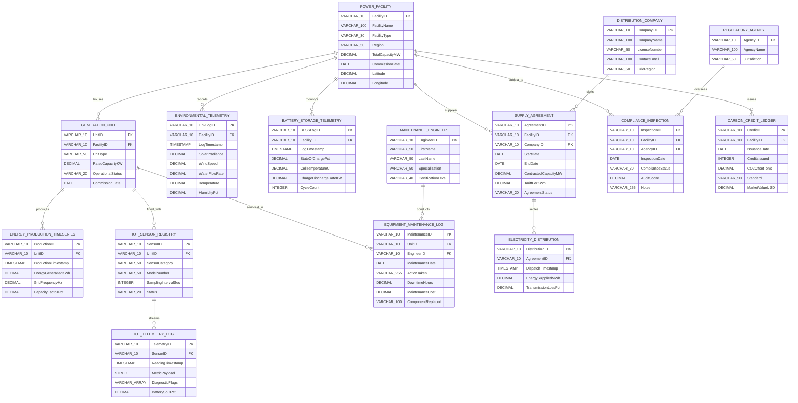

<div align="center">

# Renewable Energy DB Simulator
### Interactive Multi-Facility SCADA, Time-Series & Microgrid Database Simulator

[](https://react.dev/)
[](https://www.typescriptlang.org/)
[](https://vitejs.dev/)
[](https://motion.dev/)
[](LICENSE)
[](CONTRIBUTING.md)

<p align="center">
  An interactive microgrid relational database simulator and analytical engineering workbench. Built with React 19, TypeScript, and an obsidian-metallic wafer design system. Features an interactive 15-table entity-relationship canvas, real-time IoT telemetry streaming engine, complete in-memory CRUD table data manager, and a vectorized OLAP SQL query benchmark console.
</p>

[Explore Schema Docs](docs/DATABASE_SCHEMA.md) | [Analytical Queries](docs/ANALYTICAL_QUERIES.md) | [System Architecture](docs/ARCHITECTURE.md) | [Deployment Guide](docs/DEPLOYMENT.md)

---

</div>

## Key Features

### 1. Interactive Infinite ERD Canvas
* **Vectorized Bezier Connectors**: Smooth cubic Bezier curves dynamically route between foreign-key and primary-key anchors, calculating optimal face attachment points.
* **Pan, Zoom & Inertial Gestures**: Infinite canvas navigation with desktop mouse drag and wheel zoom, plus native multi-touch pinch-to-zoom for mobile devices (0.25x to 2.0x).
* **Live Relationship Traversal**: Click or hover any table or relationship connector to highlight dependent tables, active keys, and join cardinality badges.
* **Instant SQL DDL Generator**: Export clean, ANSI and PostgreSQL compliant `CREATE TABLE` and constraint DDL statements with a single click.
* **Quick Subsystem Filtering**: Filter the canvas view across Assets, Telemetry, Storage, Grid, and Compliance subsystems.

### 2. Real-Time IoT and SCADA Telemetry Stream
* **Automated Streaming Engine**: Simulates periodic field sensor emissions (2.8s event ticks) without blocking the UI thread.
* **Dynamic Generation Drift**: Photovoltaic arrays, wind turbines, and hydro turbines log real-time power fluctuations (kWh), grid frequency oscillations (49.95 to 50.05 Hz), and capacity factors.
* **Atmospheric & Solar Sensor Simulation**: Pyranometers, ultrasonic anemometers, and hydro flowmeters record ambient solar irradiance (W/m2), wind speeds (m/s), and temperatures.
* **Battery Energy Storage System (BESS) Dynamics**: Models real-time State of Charge (SoC%) drift, cell core temperature variations, and charge/discharge cycling on a utility-scale battery substation.

### 3. Full In-Memory CRUD Data Manager
* **Transactional In-Memory Database**: Inspect, search, filter, insert, and delete rows in real time across all 15 relational tables.
* **Global & Columnar Search**: Instant multi-column filtering with type-aware substring evaluation.
* **Smart Insertion Modal**: Built-in validation checks nullable attributes, generates timestamps, and provides dropdown pickers for valid foreign keys.
* **CSV Data Export**: Export active tables into structured CSV formats for external data science pipelines.

### 4. Vectorized Analytical SQL Query Console
* **7 Pre-Engineered Benchmarks**: Demonstrates advanced analytical time-series patterns modeled after modern columnar engines (DuckDB, TimescaleDB, ClickHouse).
* **ASOF Temporal Alignment**: Match sub-second IoT telemetry to discrete weather observations in O(N log M) time.
* **Time-Series Downsampling**: Aggregate raw intervals into 1-hour analytical dispatch windows with `time_bucket()`.
* **Rolling Window Moving Averages**: Compute 3-period rolling output baselines and automatically flag underperforming units.
* **Native PIVOT Transposition**: Reshape polymorphic sensor metrics into columnar format without manual conditional aggregations.
* **Hierarchical ROLLUP**: Multi-dimensional executive aggregations across geographic regions and facility types.
* **BESS Degradation Analytics**: Calculate battery State of Health (SoH%) based on cumulative cycle count aging.
* **EXPLAIN ANALYZE Execution Profiling**: Inspect vectorized SIMD hash joins, morsel pipelines, and columnar scan timings.

### 5. Mobile-First and Responsive UX
* Designed from the ground up to support smartphones, tablets, laptops, and ultra-wide displays.
* Touch-optimized ergonomics with tactile bottom navigation, swipeable data grids, adaptive modal sheets, and pinch-to-zoom canvas gestures.

---

## Database Subsystems and Relational Entity-Relationship Diagram (ERD)

The simulator models a comprehensive renewable energy enterprise comprising **15 normalized relational tables** organized into **5 core operational domains**:



| Subsystem | Table Name | Key Attributes & Foreign Keys | Description |
| :--- | :--- | :--- | :--- |
| **Assets** | `POWER_FACILITY` | `FacilityID` (PK), `FacilityName`, `FacilityType`, `Region`, `TotalCapacityMW`, `CommissionDate` | Master catalog of solar parks, wind farms, hydro stations, and BESS hubs |
| **Assets** | `GENERATION_UNIT` | `UnitID` (PK), `FacilityID` (FK), `UnitType`, `RatedCapacityKW`, `OperationalStatus` | Inverter blocks, wind turbines, Francis hydro turbines, BESS containers |
| **Assets** | `MAINTENANCE_ENGINEER` | `EngineerID` (PK), `FirstName`, `LastName`, `Specialization`, `CertificationLevel` | Reliability engineers and high-voltage maintenance specialists |
| **Assets** | `EQUIPMENT_MAINTENANCE_LOG` | `MaintenanceID` (PK), `UnitID` (FK), `EngineerID` (FK), `DowntimeHours`, `MaintenanceCost` | Service inspections, component replacements, downtime hours, and fiscal cost |
| **Telemetry** | `ENVIRONMENTAL_TELEMETRY` | `EnvLogID` (PK), `FacilityID` (FK), `SolarIrradiance`, `WindSpeed`, `WaterFlowRate`, `Temperature` | Boundary weather station metrics (W/m2, m/s, m3/s, °C) |
| **Telemetry** | `ENERGY_PRODUCTION_TIMESERIES`| `ProductionID` (PK), `UnitID` (FK), `EnergyGeneratedKWh`, `GridFrequencyHz`, `CapacityFactorPct` | High-frequency power generation yield records |
| **Telemetry** | `IOT_SENSOR_REGISTRY` | `SensorID` (PK), `UnitID` (FK), `SensorCategory`, `ModelNumber`, `SamplingIntervalSec` | Pyranometers, anemometers, vibration probes, flowmeters |
| **Telemetry** | `IOT_TELEMETRY_LOG` | `TelemetryID` (PK), `SensorID` (FK), `MetricPayload` (STRUCT), `DiagnosticFlags` (ARRAY) | Columnar time-series log with complex nested structures and alert tags |
| **Storage** | `BATTERY_STORAGE_TELEMETRY` | `BESSLogID` (PK), `FacilityID` (FK), `StateOfChargePct`, `CellTemperatureC`, `CycleCount` | Battery storage thermodynamics, charge/discharge rates, and cycles |
| **Grid** | `DISTRIBUTION_COMPANY` | `CompanyID` (PK), `CompanyName`, `LicenseNumber`, `ContactEmail`, `GridRegion` | Regional distribution utilities (DISCOMs) purchasing clean energy |
| **Grid** | `SUPPLY_AGREEMENT` | `AgreementID` (PK), `FacilityID` (FK), `CompanyID` (FK), `ContractedCapacityMW`, `TariffPerKWh` | Long-term Power Purchase Agreements (PPAs) |
| **Grid** | `ELECTRICITY_DISTRIBUTION` | `DistributionID` (PK), `AgreementID` (FK), `EnergySuppliedMWh`, `TransmissionLossPct` | High-voltage dispatch batches and line transmission impedance losses |
| **Compliance** | `REGULATORY_AGENCY` | `AgencyID` (PK), `AgencyName`, `Jurisdiction` | Statutory commissions (CERC, SPCB, Bureau of Energy Efficiency) |
| **Compliance** | `COMPLIANCE_INSPECTION` | `InspectionID` (PK), `FacilityID` (FK), `AgencyID` (FK), `ComplianceStatus`, `AuditScore` | Environmental safety scorecards and grid interconnection audits |
| **Compliance** | `CARBON_CREDIT_LEDGER` | `CreditID` (PK), `FacilityID` (FK), `CreditsIssued`, `CO2OffsetTons`, `Standard`, `MarketValueUSD` | Verified emission reduction certificates (Gold Standard, Verra, CDM) |

> Note: Refer to the full [Database Schema Specification](docs/DATABASE_SCHEMA.md) for complete data dictionaries, SQL DDL types, and normalization rationale.

---

## Analytical Query Showcase

Here is a glimpse of the analytical query benchmark suite available in the simulator:

### 1. Vectorized ASOF Temporal Alignment (`ASOF JOIN`)
Aligns sub-second sensor ticks with hourly atmospheric records in O(N log M) time:
```sql
SELECT 
    t.TelemetryID, t.SensorID, r.SensorCategory,
    t.ReadingTimestamp AS SensorTime,
    ROUND(t.MetricPayload.reading_value, 2) AS SensorVal,
    e.LogTimestamp AS NearestEnvTime,
    e.SolarIrradiance, e.WindSpeed, e.Temperature
FROM IOT_TELEMETRY_LOG t
JOIN IOT_SENSOR_REGISTRY r ON t.SensorID = r.SensorID
JOIN GENERATION_UNIT u ON r.UnitID = u.UnitID
ASOF JOIN ENVIRONMENTAL_TELEMETRY e 
    ON u.FacilityID = e.FacilityID 
    AND t.ReadingTimestamp >= e.LogTimestamp
ORDER BY t.ReadingTimestamp;
```

### 2. Time-Series Downsampling & Bucketing (`time_bucket`)
Downsamples millions of raw generation ticks into uniform 1-hour analytical windows:
```sql
SELECT 
    time_bucket(INTERVAL '1 hour', ProductionTimestamp) AS TimeWindow,
    u.FacilityID, COUNT(ProductionID) AS ReadingCount,
    ROUND(SUM(EnergyGeneratedKWh), 2) AS TotalEnergyKWh,
    ROUND(AVG(CapacityFactorPct), 2) AS AvgCapacityFactorPct
FROM ENERGY_PRODUCTION_TIMESERIES p
JOIN GENERATION_UNIT u ON p.UnitID = u.UnitID
GROUP BY TimeWindow, u.FacilityID
ORDER BY TimeWindow, u.FacilityID;
```

### 3. Dynamic Anomaly Detection with Moving Window Frames
Computes rolling 3-period baselines and flags equipment underperformance (less than 90% of baseline):
```sql
SELECT 
    ProductionID, UnitID, ProductionTimestamp, EnergyGeneratedKWh,
    ROUND(AVG(EnergyGeneratedKWh) OVER (
        PARTITION BY UnitID ORDER BY ProductionTimestamp 
        ROWS BETWEEN 2 PRECEDING AND CURRENT ROW
    ), 2) AS RollingAvg3PeriodKWh,
    CASE 
        WHEN EnergyGeneratedKWh < 0.90 * AVG(EnergyGeneratedKWh) OVER (
            PARTITION BY UnitID ORDER BY ProductionTimestamp 
            ROWS BETWEEN 2 PRECEDING AND CURRENT ROW
        ) THEN 'UNDERPERFORMING'
        ELSE 'NORMAL'
    END AS PerformanceFlag
FROM ENERGY_PRODUCTION_TIMESERIES
ORDER BY UnitID, ProductionTimestamp;
```

> Note: Refer to [Analytical Queries and Benchmarks](docs/ANALYTICAL_QUERIES.md) for all 7 queries, execution plans, and output schemas.

---

## Technology Stack

| Layer | Technologies |
| :--- | :--- |
| **Core Framework** | [React 19](https://react.dev/) with [TypeScript 6.0](https://www.typescriptlang.org/) |
| **Build Engine** | [Vite 8.3](https://vitejs.dev/) with lightning-fast HMR and ESM bundling |
| **Motion & Physics** | [Motion (Framer Motion) 14.1](https://motion.dev/) for gesture physics and animations |
| **Visual Effects & Icons** | [Lucide React](https://lucide.dev/) (industrial icon set) & [Canvas Confetti](https://www.npmjs.com/package/canvas-confetti) |
| **Linter & Static Analysis** | [Oxlint 1.81](https://oxc.rs/docs/guide/usage/linter) (Rust-powered high performance linter) |
| **Styling Architecture** | Pure Vanilla CSS Design System with CSS variables and glassmorphism |

---

## Quick Start and Installation

### Prerequisites
* **Node.js**: v18.0.0 or later (v20+ recommended)
* **npm**: v9.0.0 or later

### Installation Steps

```bash
# 1. Clone the repository
git clone https://github.com/rudy-07/Renewable-Energy-Simulator.git

# 2. Navigate to project root
cd Renewable-Energy-Simulator

# 3. Install dependencies
npm install

# 4. Start local Vite development server
npm run dev
```

Open [http://localhost:5173](http://localhost:5173) in your browser.

### Available Scripts

| Script | Command | Purpose |
| :--- | :--- | :--- |
| **Development** | `npm run dev` | Starts local development server with Hot Module Replacement |
| **Type Check & Build** | `npm run build` | Compiles TypeScript (`tsc -b`) and generates production bundle in `dist/` |
| **Code Linting** | `npm run lint` | Runs Rust-based Oxlint static analysis |
| **Production Preview** | `npm run preview` | Locally serves production build from `dist/` |

---

## Project Directory Structure

```
Renewable-Energy-Simulator/
├── .oxlintrc.json              # Oxlint linting rules and plugins
├── dist/                       # Compiled production bundle
├── docs/                       # Comprehensive documentation suite
│   ├── ANALYTICAL_QUERIES.md   # OLAP SQL query benchmarks & analysis
│   ├── ARCHITECTURE.md         # Technical architecture & design system
│   ├── DATABASE_SCHEMA.md      # Full 15-table relational specification & ERD
│   └── DEPLOYMENT.md           # Production deployment instructions (Vercel, Docker)
├── index.html                  # HTML entry point with responsive viewport settings
├── package.json                # Project dependencies and script declarations
├── public/                     # Static assets, SVG icons, and redirects
│   ├── _redirects              # SPA routing rewrite rule for Netlify
│   ├── favicon.svg             # Clean-tech vector favicon
│   └── icons.svg               # SVG sprite definitions
├── src/
│   ├── App.css                 # Application-wide utility classes
│   ├── App.tsx                 # Root component: Tab navigation & IoT tick engine
│   ├── components/             # Core UI components
│   │   ├── DashboardOverview.tsx      # High-level operations & telemetry dashboard
│   │   ├── DatabaseSchemaCanvas.tsx   # Interactive ERD canvas with Bezier curves
│   │   ├── Navbar.tsx                 # Responsive header with subsystem badges
│   │   ├── QueryConsole.tsx           # Analytical SQL console & benchmark viewer
│   │   ├── RecordModal.tsx            # Foreign-key validated insert record modal
│   │   └── TableManager.tsx           # Searchable, sortable CRUD data manager
│   ├── data/
│   │   └── databaseData.ts            # Schema definitions, seed rows, benchmark queries
│   ├── hooks/
│   │   └── useMediaQuery.ts           # Dynamic responsive breakpoint hook
│   ├── index.css               # Design tokens, metallic theme variables, typography
│   └── main.tsx                # React DOM root bootstrapping
├── tsconfig.json               # TypeScript workspace compiler settings
├── vite.config.ts              # Vite bundler configuration
├── LICENSE                     # MIT Open Source License
└── README.md                   # Project overview & documentation index
```

---

## License

This project is licensed under the MIT License. See the [LICENSE](LICENSE) file for details.

---

<div align="center">
  <sub>Built with clean-tech precision by <a href="https://github.com/rudy-07">rudy-07</a>. Star this repository if you find it helpful.</sub>
</div>
