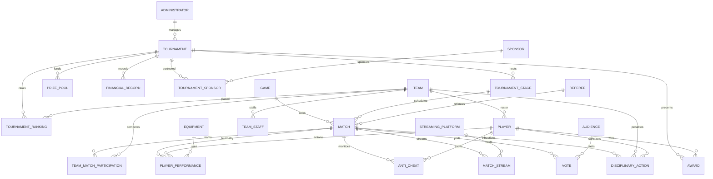

# Global E-Sports Tournament Management Database Schema

Comprehensive data dictionary, entity-relationship specifications, and relational normalization analysis for the 24-table e-sports tournament management database simulator.

---

## 1. Entity-Relationship Diagram (Mermaid ERD)

---

## 2. Subsystem Data Dictionaries

### Subsystem 1: Organization & Roster Architecture

#### `TOURNAMENT`
Stores premier championship events, LAN majors, and circuit seasons.
* **Oracle Types**: `TournamentID VARCHAR2(10) PK`, `TournamentName VARCHAR2(100) NOT NULL`, `StartDate DATE NOT NULL`, `EndDate DATE NOT NULL`, `Location VARCHAR2(100)`, `TournamentType VARCHAR2(50)`, `AdminID VARCHAR2(10) FK -> ADMINISTRATOR(AdminID)`
* **PostgreSQL Types**: `tournament_id VARCHAR(10) PRIMARY KEY`, `tournament_name VARCHAR(100) NOT NULL`, `start_date DATE NOT NULL`, `end_date DATE NOT NULL`, `location VARCHAR(100)`, `tournament_type VARCHAR(50)`, `admin_id VARCHAR(10) REFERENCES administrator(admin_id)`

#### `GAME`
Competitive esports game titles officiated in the tournaments.
* **Oracle Types**: `GameID VARCHAR2(10) PK`, `GameName VARCHAR2(100) NOT NULL`, `Genre VARCHAR2(50)`, `Publisher VARCHAR2(100)`
* **PostgreSQL Types**: `game_id VARCHAR(10) PRIMARY KEY`, `game_name VARCHAR(100) NOT NULL`, `genre VARCHAR(50)`, `publisher VARCHAR(100)`

#### `TOURNAMENT_STAGE`
Sequential bracket phases within a tournament (Group Stage, Knockouts, Semifinals, Grand Final).
* **Oracle Types**: `StageID VARCHAR2(10) PK`, `StageName VARCHAR2(100) NOT NULL`, `StageType VARCHAR2(50) [League|Knockout|Semifinal|Final]`, `StartDate DATE`, `EndDate DATE`, `TournamentID VARCHAR2(10) FK -> TOURNAMENT(TournamentID)`
* **PostgreSQL Types**: `stage_id VARCHAR(10) PRIMARY KEY`, `stage_name VARCHAR(100) NOT NULL`, `stage_type VARCHAR(50)`, `start_date DATE`, `end_date DATE`, `tournament_id VARCHAR(10) REFERENCES tournament(tournament_id)`

#### `TEAM`
Competitive professional esports franchises and organizations.
* **Oracle Types**: `TeamID VARCHAR2(10) PK`, `TeamName VARCHAR2(100) NOT NULL`, `Country VARCHAR2(50)`, `Ranking NUMBER(4)`
* **PostgreSQL Types**: `team_id VARCHAR(10) PRIMARY KEY`, `team_name VARCHAR(100) NOT NULL`, `country VARCHAR(50)`, `ranking INTEGER`

#### `PLAYER`
Professional athletes contracted to teams with defined tactical roles.
* **Oracle Types**: `PlayerID VARCHAR2(10) PK`, `PlayerName VARCHAR2(100) NOT NULL`, `Country VARCHAR2(50)`, `TeamID VARCHAR2(10) FK -> TEAM(TeamID)`, `PlayerRole VARCHAR2(50)`, `IsSubstitute NUMBER(1) DEFAULT 0`
* **PostgreSQL Types**: `player_id VARCHAR(10) PRIMARY KEY`, `player_name VARCHAR(100) NOT NULL`, `country VARCHAR(50)`, `team_id VARCHAR(10) REFERENCES team(team_id)`, `player_role VARCHAR(50)`, `is_substitute SMALLINT DEFAULT 0`

#### `TEAM_STAFF`
Coaching, strategic analysis, and management personnel supporting team rosters.
* **Oracle Types**: `StaffID VARCHAR2(10) PK`, `TeamID VARCHAR2(10) FK -> TEAM(TeamID)`, `StaffName VARCHAR2(100) NOT NULL`, `StaffRole VARCHAR2(50) [Coach|Analyst|Manager]`, `ContactNo VARCHAR2(30)`
* **PostgreSQL Types**: `staff_id VARCHAR(10) PRIMARY KEY`, `team_id VARCHAR(10) REFERENCES team(team_id)`, `staff_name VARCHAR(100) NOT NULL`, `staff_role VARCHAR(50)`, `contact_no VARCHAR(30)`

#### `EQUIPMENT`
Certified tournament hardware and peripherals deployed on stage.
* **Oracle Types**: `EquipmentID VARCHAR2(10) PK`, `EquipmentName VARCHAR2(100) NOT NULL`, `EquipmentType VARCHAR2(50)`, `Brand VARCHAR2(50)`
* **PostgreSQL Types**: `equipment_id VARCHAR(10) PRIMARY KEY`, `equipment_name VARCHAR(100) NOT NULL`, `equipment_type VARCHAR(50)`, `brand VARCHAR(50)`

---

### Subsystem 2: Match Telemetry & In-Game Analytics

#### `MATCH`
Official competitive fixtures played between teams.
* **Oracle Types**: `MatchID VARCHAR2(10) PK`, `StageID VARCHAR2(10) FK -> TOURNAMENT_STAGE(StageID)`, `GameID VARCHAR2(10) FK -> GAME(GameID)`, `MatchDate DATE`, `MatchTime VARCHAR2(10)`, `MatchResult VARCHAR2(50)`, `MatchStatus VARCHAR2(50) [Scheduled|Live|Completed]`, `RefereeID VARCHAR2(10) FK -> REFEREE(RefereeID)`
* **PostgreSQL Types**: `match_id VARCHAR(10) PRIMARY KEY`, `stage_id VARCHAR(10) REFERENCES tournament_stage(stage_id)`, `game_id VARCHAR(10) REFERENCES game(game_id)`, `match_date DATE`, `match_time VARCHAR(10)`, `match_result VARCHAR(50)`, `match_status VARCHAR(50)`, `referee_id VARCHAR(10) REFERENCES referee(referee_id)`

#### `TEAM_MATCH_PARTICIPATION`
Composite junction table tracking bilateral team engagement per match and round score.
* **Oracle Types**: `MatchID VARCHAR2(10) FK -> MATCH(MatchID)`, `TeamID VARCHAR2(10) FK -> TEAM(TeamID)`, `Result VARCHAR2(50) [Win|Loss|Pending]`, `TeamScore NUMBER(4)`, `PRIMARY KEY (MatchID, TeamID)`
* **PostgreSQL Types**: `match_id VARCHAR(10) REFERENCES match(match_id)`, `team_id VARCHAR(10) REFERENCES team(team_id)`, `result VARCHAR(50)`, `team_score INTEGER`, `PRIMARY KEY (match_id, team_id)`

#### `MATCH_MAP`
Individual map instances within Best-of-3 and Best-of-5 competitive series fixtures.
* **Oracle Types**: `MapID VARCHAR2(10) PK`, `MatchID VARCHAR2(10) FK -> MATCH(MatchID)`, `MapName VARCHAR2(50) NOT NULL [Lotus|Sunset|Split|Ascent|Abyss]`, `MapOrder NUMBER(2) NOT NULL`, `WinnerTeamID VARCHAR2(10) FK -> TEAM(TeamID)`, `Team1Score NUMBER(3)`, `Team2Score NUMBER(3)`, `RoundsPlayed NUMBER(3)`
* **PostgreSQL Types**: `map_id VARCHAR(10) PRIMARY KEY`, `match_id VARCHAR(10) REFERENCES match(match_id)`, `map_name VARCHAR(50) NOT NULL`, `map_order INTEGER NOT NULL`, `winner_team_id VARCHAR(10) REFERENCES team(team_id)`, `team1_score INTEGER`, `team2_score INTEGER`, `rounds_played INTEGER`

#### `PLAYER_PERFORMANCE`
High-resolution athlete combat telemetry and hardware telemetry per map instance.
* **Oracle Types**: `PerformanceID VARCHAR2(10) PK`, `PlayerID VARCHAR2(10) FK -> PLAYER(PlayerID)`, `MatchID VARCHAR2(10) FK -> MATCH(MatchID)`, `MapID VARCHAR2(10) FK -> MATCH_MAP(MapID)`, `RoundsPlayed NUMBER(3) NOT NULL`, `DamageDealt NUMBER(6)`, `TotalCombatScore NUMBER(6)`, `ACS NUMBER(5,1)`, `ADR NUMBER(5,1)`, `Score NUMBER(6)`, `Kills NUMBER(4)`, `Assists NUMBER(4)`, `Deaths NUMBER(4)`, `FirstKills NUMBER(4)`, `FirstDeaths NUMBER(4)`, `ImpactIndex NUMBER(4,2)`, `EquipmentID VARCHAR2(10) FK -> EQUIPMENT(EquipmentID)`, `InternetLatencyMs NUMBER(5,1)`, `GameplayAnalytics VARCHAR2(255)`
* **PostgreSQL Types**: `performance_id VARCHAR(10) PRIMARY KEY`, `player_id VARCHAR(10) REFERENCES player(player_id)`, `match_id VARCHAR(10) REFERENCES match(match_id)`, `map_id VARCHAR(10) REFERENCES match_map(map_id)`, `rounds_played INTEGER NOT NULL`, `damage_dealt INTEGER`, `total_combat_score INTEGER`, `acs NUMERIC(5,1)`, `adr NUMERIC(5,1)`, `score INTEGER`, `kills INTEGER`, `assists INTEGER`, `deaths INTEGER`, `first_kills INTEGER`, `first_deaths INTEGER`, `impact_index NUMERIC(4,2)`, `equipment_id VARCHAR(10) REFERENCES equipment(equipment_id)`, `internet_latency_ms NUMERIC(5,1)`, `gameplay_analytics VARCHAR(255)`

---

### Subsystem 3: Finance, Sponsorship & Results

#### `SPONSOR`
Corporate brands and technology partners backing events.
* **Oracle Types**: `SponsorID VARCHAR2(10) PK`, `SponsorName VARCHAR2(100) NOT NULL`, `ContactNo VARCHAR2(30)`, `Email VARCHAR2(100)`, `SponsorType VARCHAR2(50)`
* **PostgreSQL Types**: `sponsor_id VARCHAR(10) PRIMARY KEY`, `sponsor_name VARCHAR(100) NOT NULL`, `contact_no VARCHAR(30)`, `email VARCHAR(100)`, `sponsor_type VARCHAR(50)`

#### `TOURNAMENT_SPONSOR`
Composite junction establishing financial contributions committed by sponsors per event.
* **Oracle Types**: `TournamentID VARCHAR2(10) FK -> TOURNAMENT(TournamentID)`, `SponsorID VARCHAR2(10) FK -> SPONSOR(SponsorID)`, `SponsorshipAmount NUMBER(12,2)`, `PRIMARY KEY (TournamentID, SponsorID)`
* **PostgreSQL Types**: `tournament_id VARCHAR(10) REFERENCES tournament(tournament_id)`, `sponsor_id VARCHAR(10) REFERENCES sponsor(sponsor_id)`, `sponsorship_amount NUMERIC(12,2)`, `PRIMARY KEY (tournament_id, sponsor_id)`

#### `PRIZE_POOL`
Prize distribution reserve and pool metadata per tournament.
* **Oracle Types**: `PrizePoolID VARCHAR2(10) PK`, `TournamentID VARCHAR2(10) FK -> TOURNAMENT(TournamentID)`, `TotalAmount NUMBER(12,2)`, `Currency VARCHAR2(10)`, `DistributionDate DATE`
* **PostgreSQL Types**: `prize_pool_id VARCHAR(10) PRIMARY KEY`, `tournament_id VARCHAR(10) REFERENCES tournament(tournament_id)`, `total_amount NUMERIC(12,2)`, `currency VARCHAR(10)`, `distribution_date DATE`

#### `FINANCIAL_RECORD`
Fiscal ledger tracking event cash inflows, venue expenditures, and payouts.
* **Oracle Types**: `RecordID VARCHAR2(10) PK`, `TournamentID VARCHAR2(10) FK -> TOURNAMENT(TournamentID)`, `RecordType VARCHAR2(50) [Revenue|Expense|Prize Payout]`, `Amount NUMBER(12,2)`, `TransactionDate DATE`
* **PostgreSQL Types**: `record_id VARCHAR(10) PRIMARY KEY`, `tournament_id VARCHAR(10) REFERENCES tournament(tournament_id)`, `record_type VARCHAR(50)`, `amount NUMERIC(12,2)`, `transaction_date DATE`

#### `AWARD`
Accolades granted to standout competitors or organizations (MVP, Fair Play).
* **Oracle Types**: `AwardID VARCHAR2(10) PK`, `TournamentID VARCHAR2(10) FK -> TOURNAMENT(TournamentID)`, `PlayerID VARCHAR2(10) FK -> PLAYER(PlayerID) NULL`, `TeamID VARCHAR2(10) FK -> TEAM(TeamID) NULL`, `AwardName VARCHAR2(100) NOT NULL`, `AwardType VARCHAR2(50)`, `AwardDate DATE`
* **PostgreSQL Types**: `award_id VARCHAR(10) PRIMARY KEY`, `tournament_id VARCHAR(10) REFERENCES tournament(tournament_id)`, `player_id VARCHAR(10) REFERENCES player(player_id)`, `team_id VARCHAR(10) REFERENCES team(team_id)`, `award_name VARCHAR(100) NOT NULL`, `award_type VARCHAR(50)`, `award_date DATE`

#### `TOURNAMENT_RANKING`
Final competitive placements and prize payouts achieved by teams.
* **Oracle Types**: `TournamentID VARCHAR2(10) FK -> TOURNAMENT(TournamentID)`, `TeamID VARCHAR2(10) FK -> TEAM(TeamID)`, `FinalRank NUMBER(4)`, `PrizeAmount NUMBER(12,2)`, `PRIMARY KEY (TournamentID, TeamID)`
* **PostgreSQL Types**: `tournament_id VARCHAR(10) REFERENCES tournament(tournament_id)`, `team_id VARCHAR(10) REFERENCES team(team_id)`, `final_rank INTEGER`, `prize_amount NUMERIC(12,2)`, `PRIMARY KEY (tournament_id, team_id)`

---

### Subsystem 4: Broadcast & Audience Engagement

#### `STREAMING_PLATFORM`
Broadcast networks and digital OTT channels distributing match feeds.
* **Oracle Types**: `PlatformID VARCHAR2(10) PK`, `PlatformName VARCHAR2(100) NOT NULL`, `PlatformType VARCHAR2(50)`, `ContactInfo VARCHAR2(100)`
* **PostgreSQL Types**: `platform_id VARCHAR(10) PRIMARY KEY`, `platform_name VARCHAR(100) NOT NULL`, `platform_type VARCHAR(50)`, `contact_info VARCHAR(100)`

#### `MATCH_STREAM`
Live stream channel telemetry and peak concurrent viewership count.
* **Oracle Types**: `MatchID VARCHAR2(10) FK -> MATCH(MatchID)`, `PlatformID VARCHAR2(10) FK -> STREAMING_PLATFORM(PlatformID)`, `PeakViewers NUMBER(9)`, `PRIMARY KEY (MatchID, PlatformID)`
* **PostgreSQL Types**: `match_id VARCHAR(10) REFERENCES match(match_id)`, `platform_id VARCHAR(10) REFERENCES streaming_platform(platform_id)`, `peak_viewers INTEGER`, `PRIMARY KEY (match_id, platform_id)`

#### `AUDIENCE`
Registered community members and spectators participating in fan engagement.
* **Oracle Types**: `AudienceID VARCHAR2(10) PK`, `AudienceName VARCHAR2(100) NOT NULL`, `Email VARCHAR2(100) NOT NULL`, `ContactNo VARCHAR2(30)`
* **PostgreSQL Types**: `audience_id VARCHAR(10) PRIMARY KEY`, `audience_name VARCHAR(100) NOT NULL`, `email VARCHAR(100) NOT NULL`, `contact_no VARCHAR(30)`

#### `VOTE`
Fan-driven ballots cast for Match MVP, Best Team, or Match of the Day.
* **Oracle Types**: `VoteID VARCHAR2(10) PK`, `AudienceID VARCHAR2(10) FK -> AUDIENCE(AudienceID)`, `MatchID VARCHAR2(10) FK -> MATCH(MatchID)`, `VoteType VARCHAR2(50) [Best Player|Best Team|Match of the Day]`, `VoteDate DATE`
* **PostgreSQL Types**: `vote_id VARCHAR(10) PRIMARY KEY`, `audience_id VARCHAR(10) REFERENCES audience(audience_id)`, `match_id VARCHAR(10) REFERENCES match(match_id)`, `vote_type VARCHAR(50)`, `vote_date DATE`

---

### Subsystem 5: Integrity, Officiating & Discipline

#### `ADMINISTRATOR`
Executive tournament directors and league officials.
* **Oracle Types**: `AdminID VARCHAR2(10) PK`, `AdminName VARCHAR2(100) NOT NULL`, `ContactNo VARCHAR2(30)`, `Email VARCHAR2(100) UNIQUE NOT NULL`
* **PostgreSQL Types**: `admin_id VARCHAR(10) PRIMARY KEY`, `admin_name VARCHAR(100) NOT NULL`, `contact_no VARCHAR(30)`, `email VARCHAR(100) UNIQUE NOT NULL`

#### `REFEREE`
Certified head and assistant referees presiding over matches.
* **Oracle Types**: `RefereeID VARCHAR2(10) PK`, `RefereeName VARCHAR2(100) NOT NULL`, `ContactNo VARCHAR2(30)`, `ExperienceYears NUMBER(3)`
* **PostgreSQL Types**: `referee_id VARCHAR(10) PRIMARY KEY`, `referee_name VARCHAR(100) NOT NULL`, `contact_no VARCHAR(30)`, `experience_years INTEGER`

#### `ANTI_CHEAT`
Integrity telemetry tracking cheat detection engine audits and anomalous gameplay alerts.
* **Oracle Types**: `AntiCheatID VARCHAR2(10) PK`, `MatchID VARCHAR2(10) FK -> MATCH(MatchID)`, `PlayerID VARCHAR2(10) FK -> PLAYER(PlayerID)`, `CheatStatus VARCHAR2(50) [Clean|Flagged|Under Review]`, `MonitoringDetails VARCHAR2(255)`
* **PostgreSQL Types**: `anti_cheat_id VARCHAR(10) PRIMARY KEY`, `match_id VARCHAR(10) REFERENCES match(match_id)`, `player_id VARCHAR(10) REFERENCES player(player_id)`, `cheat_status VARCHAR(50)`, `monitoring_details VARCHAR(255)`

#### `DISCIPLINARY_ACTION`
Official penalties, warnings, fines, and bans issued against players or organizations.
* **Oracle Types**: `ActionID VARCHAR2(10) PK`, `PlayerID VARCHAR2(10) FK -> PLAYER(PlayerID) NULL`, `TeamID VARCHAR2(10) FK -> TEAM(TeamID) NULL`, `MatchID VARCHAR2(10) FK -> MATCH(MatchID)`, `ActionType VARCHAR2(50) [Warning|Fine|Disqualification|Match Ban]`, `Penalty VARCHAR2(255)`, `ActionDate DATE`
* **PostgreSQL Types**: `action_id VARCHAR(10) PRIMARY KEY`, `player_id VARCHAR(10) REFERENCES player(player_id)`, `team_id VARCHAR(10) REFERENCES team(team_id)`, `match_id VARCHAR(10) REFERENCES match(match_id)`, `action_type VARCHAR(50)`, `penalty VARCHAR(255)`, `action_date DATE`

---

## 3. Relational Normalization Analysis

### First Normal Form (1NF)
* All attributes contain strictly atomic, scalar values.
* Multi-valued attributes (such as multiple players per team, multiple staff roles, or participating match teams) are factored out into dedicated child or associative tables (`PLAYER`, `TEAM_STAFF`, `TEAM_MATCH_PARTICIPATION`).
* Every relation has a clearly defined primary key (single attribute surrogate or composite natural key).

### Second Normal Form (2NF)
* The schema is in 1NF and contains zero partial functional dependencies.
* For tables with composite primary keys (`TEAM_MATCH_PARTICIPATION`, `TOURNAMENT_SPONSOR`, `MATCH_STREAM`, `TOURNAMENT_RANKING`):
  * In `TEAM_MATCH_PARTICIPATION`, `Result` and `TeamScore` depend entirely on the composite candidate key `(MatchID, TeamID)`, not solely on `MatchID` or `TeamID`.
  * In `TOURNAMENT_SPONSOR`, `SponsorshipAmount` depends strictly on the pair `(TournamentID, SponsorID)`.
  * In `MATCH_STREAM`, `PeakViewers` represents concurrent reach specifically for a match broadcast on a chosen platform, depending fully on `(MatchID, PlatformID)`.

### Third Normal Form (3NF)
* The schema satisfies 2NF and contains no transitive functional dependencies ($X \to Y$ and $Y \to Z$ where $Z$ is a non-prime attribute).
* Non-key columns depend only on the primary key:
  * Team country and ranking reside in `TEAM`; player records store only `TeamID` rather than duplicating team attributes.
  * Tournament dates and admin info reside in `TOURNAMENT`; stages reference `TournamentID` without redundantly capturing tournament attributes.
  * Disciplinary actions reference `MatchID`, `PlayerID`, or `TeamID`, preserving single-source truth for sanctions without duplicating player or team metadata.

### Boyce-Codd Normal Form (BCNF)
* For every non-trivial functional dependency $X \to Y$, $X$ is a superkey.
* Candidate keys in associative entities (`MatchID + TeamID`, `TournamentID + SponsorID`) are minimal superkeys with no overlapping non-trivial determinants.
