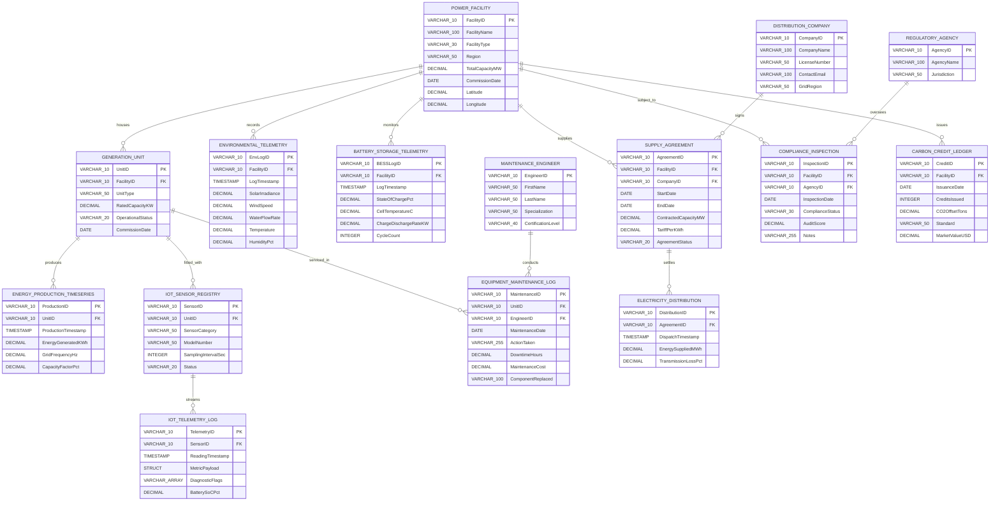

# Database Schema and Relational Architecture Specification

The **Renewable Energy DB Simulator** models a multi-facility renewable energy microgrid and utility distribution network. The architecture bridges operational enterprise asset management (EAM), high-frequency Internet of Things (IoT) sensor telemetry, Battery Energy Storage Systems (BESS), utility power purchase agreements (PPA), and statutory environmental compliance.

---

## Relational Entity-Relationship Diagram (ERD)

The diagram below specifies all 15 relational tables, their primary keys (PK), foreign keys (FK), column attributes, and relational cardinalities across the microgrid:

---

## Subsystem Organization

The schema comprises **15 normalized relational tables** structured across **5 specialized operational subsystems**:

| Subsystem | Color Identifier | Primary Responsibility | Tables Included |
| :--- | :--- | :--- | :--- |
| **Assets** | Metallic Silver | Physical microgrid infrastructure and personnel | `POWER_FACILITY`, `GENERATION_UNIT`, `MAINTENANCE_ENGINEER`, `EQUIPMENT_MAINTENANCE_LOG` |
| **Telemetry** | Zinc Steel | Streaming SCADA logs and high-frequency time-series | `ENVIRONMENTAL_TELEMETRY`, `ENERGY_PRODUCTION_TIMESERIES`, `IOT_SENSOR_REGISTRY`, `IOT_TELEMETRY_LOG` |
| **Storage** | Amber Gold | Electrochemical BESS telemetry and cycle life | `BATTERY_STORAGE_TELEMETRY` |
| **Grid** | Slate Gray | Utility PPAs, transmission dispatches, and losses | `DISTRIBUTION_COMPANY`, `SUPPLY_AGREEMENT`, `ELECTRICITY_DISTRIBUTION` |
| **Compliance** | Emerald Green | Statutory audits, emissions offsets, and ESG ledger | `REGULATORY_AGENCY`, `COMPLIANCE_INSPECTION`, `CARBON_CREDIT_LEDGER` |

---

## Comprehensive Data Dictionaries

### 1. Subsystem: Assets

#### `POWER_FACILITY`
Master registry of renewable energy generating complexes, regional distribution hubs, and storage facilities.

| Column | Type | Constraints | Description |
| :--- | :--- | :--- | :--- |
| `FacilityID` | `VARCHAR(10)` | **PRIMARY KEY** | Unique facility identification code (example: `FAC01`) |
| `FacilityName` | `VARCHAR(100)` | `NOT NULL` | Commercial facility name (example: *Bhadla Solar Park*) |
| `FacilityType` | `ENUM` | `NOT NULL` | Plant classification: `Solar Farm`, `Wind Farm`, `Hydroelectric Station`, `Battery Storage` |
| `Region` | `VARCHAR(50)` | `NOT NULL` | Geographic province or administrative state |
| `TotalCapacityMW` | `DECIMAL(10,2)` | `NOT NULL` | Nameplate aggregate generation or storage capacity in Megawatts |
| `CommissionDate` | `DATE` | `NOT NULL` | Commercial Operation Date (COD) of grid synchronization |
| `Latitude` | `DECIMAL(8,4)` | `NULLABLE` | Geospatial latitude coordinate (WGS84) |
| `Longitude` | `DECIMAL(8,4)` | `NULLABLE` | Geospatial longitude coordinate (WGS84) |

#### `GENERATION_UNIT`
Individual generation assets (photovoltaic inverter blocks, wind turbine generators, hydro Francis or Kaplan units, BESS container racks).

| Column | Type | Constraints | Description |
| :--- | :--- | :--- | :--- |
| `UnitID` | `VARCHAR(10)` | **PRIMARY KEY** | Unique generation asset identifier (example: `U101`) |
| `FacilityID` | `VARCHAR(10)` | **FOREIGN KEY** to `POWER_FACILITY(FacilityID)` | Parent power facility |
| `UnitType` | `VARCHAR(50)` | `NOT NULL` | Equipment specification (example: `Vestas V126 Wind Turbine`) |
| `RatedCapacityKW`| `DECIMAL(10,2)` | `NOT NULL` | Unit rated peak electrical capacity in Kilowatts |
| `OperationalStatus`| `ENUM` | `DEFAULT 'Operational'` | Status: `Operational`, `Maintenance`, `Offline`, `Decommissioned` |
| `CommissionDate` | `DATE` | `NOT NULL` | Interconnection and commissioning date |

#### `MAINTENANCE_ENGINEER`
Certified field engineers, asset technicians, and maintenance leads.

| Column | Type | Constraints | Description |
| :--- | :--- | :--- | :--- |
| `EngineerID` | `VARCHAR(10)` | **PRIMARY KEY** | Unique engineering personnel identifier (example: `ENG01`) |
| `FirstName` | `VARCHAR(50)` | `NOT NULL` | Engineer legal first name |
| `LastName` | `VARCHAR(50)` | `NOT NULL` | Engineer legal last name |
| `Specialization` | `VARCHAR(50)` | `NOT NULL` | Domain focus (example: `Solar Inverters & High Voltage`) |
| `CertificationLevel`| `VARCHAR(40)`| `NOT NULL` | Professional engineering certification |

#### `EQUIPMENT_MAINTENANCE_LOG`
Comprehensive service records, component replacements, downtime hours, and fiscal cost accounting.

| Column | Type | Constraints | Description |
| :--- | :--- | :--- | :--- |
| `MaintenanceID` | `VARCHAR(10)` | **PRIMARY KEY** | Maintenance event record ID (example: `MNT01`) |
| `UnitID` | `VARCHAR(10)` | **FOREIGN KEY** to `GENERATION_UNIT(UnitID)` | Unit serviced |
| `EngineerID` | `VARCHAR(10)` | **FOREIGN KEY** to `MAINTENANCE_ENGINEER(EngineerID)` | Lead certifying engineer |
| `MaintenanceDate`| `DATE` | `NOT NULL` | Date corrective or preventative action took place |
| `ActionTaken` | `VARCHAR(255)`| `NOT NULL` | Detailed work description |
| `DowntimeHours` | `DECIMAL(6,2)` | `NOT NULL` | Asset outage duration in hours |
| `MaintenanceCost`| `DECIMAL(10,2)`| `NOT NULL` | Aggregate cost in currency units (parts and labor) |
| `ComponentReplaced`| `VARCHAR(100)`| `NULLABLE` | Serialized replacement hardware part name |

---

### 2. Subsystem: Telemetry

#### `ENVIRONMENTAL_TELEMETRY`
Ambient atmospheric and hydrological conditions logged at plant boundary weather stations.

| Column | Type | Constraints | Description |
| :--- | :--- | :--- | :--- |
| `EnvLogID` | `VARCHAR(10)` | **PRIMARY KEY** | Unique environmental telemetry record ID |
| `FacilityID` | `VARCHAR(10)` | **FOREIGN KEY** to `POWER_FACILITY(FacilityID)` | Parent plant |
| `LogTimestamp` | `TIMESTAMP` | `NOT NULL` | Exact UTC observation timestamp |
| `SolarIrradiance`| `DECIMAL(8,2)` | `DEFAULT 0.00` | Global Horizontal Irradiance in W/m2 |
| `WindSpeed` | `DECIMAL(6,2)` | `DEFAULT 0.00` | Anemometer wind speed in m/s |
| `WaterFlowRate` | `DECIMAL(8,2)` | `DEFAULT 0.00` | Penstock water discharge velocity in m3/s |
| `Temperature` | `DECIMAL(5,2)` | `NOT NULL` | Ambient temperature in degrees Celsius (°C) |
| `HumidityPct` | `DECIMAL(5,2)` | `NULLABLE` | Relative atmospheric humidity percentage |

#### `ENERGY_PRODUCTION_TIMESERIES`
High-resolution generation records logged per unit for grid integration and power yield dispatch.

| Column | Type | Constraints | Description |
| :--- | :--- | :--- | :--- |
| `ProductionID` | `VARCHAR(10)` | **PRIMARY KEY** | Time-series generation interval ID |
| `UnitID` | `VARCHAR(10)` | **FOREIGN KEY** to `GENERATION_UNIT(UnitID)` | Specific generating unit |
| `ProductionTimestamp`| `TIMESTAMP` | `NOT NULL` | Interval end timestamp |
| `EnergyGeneratedKWh` | `DECIMAL(12,2)` | `NOT NULL` | Net electrical energy produced in Kilowatt-hours |
| `GridFrequencyHz` | `DECIMAL(5,2)` | `DEFAULT 50.00` | Microgrid or interconnection line frequency in Hertz |
| `CapacityFactorPct` | `DECIMAL(5,2)` | `NOT NULL` | Operational capacity factor percentage |

#### `IOT_SENSOR_REGISTRY`
Physical and logical sensor inventory deployed on turbines, inverters, and transformers.

| Column | Type | Constraints | Description |
| :--- | :--- | :--- | :--- |
| `SensorID` | `VARCHAR(10)` | **PRIMARY KEY** | Hardware sensor serial index (example: `SEN01`) |
| `UnitID` | `VARCHAR(10)` | **FOREIGN KEY** to `GENERATION_UNIT(UnitID)` | Unit monitored by sensor |
| `SensorCategory`| `VARCHAR(50)` | `NOT NULL` | Transducer category (example: `Pyranometer`, `Anemometer`) |
| `ModelNumber` | `VARCHAR(50)` | `NOT NULL` | OEM device catalog number |
| `SamplingIntervalSec`| `INTEGER` | `DEFAULT 10` | Hardware polling period in seconds |
| `Status` | `VARCHAR(20)` | `DEFAULT 'Active'` | Health status (`Active`, `Fault`, `Calibrating`) |

#### `IOT_TELEMETRY_LOG`
Streaming time-series payload log utilizing modern columnar complex types (`STRUCT` and array `VARCHAR[]`).

| Column | Type | Constraints | Description |
| :--- | :--- | :--- | :--- |
| `TelemetryID` | `VARCHAR(10)` | **PRIMARY KEY** | Telemetry frame ID |
| `SensorID` | `VARCHAR(10)` | **FOREIGN KEY** to `IOT_SENSOR_REGISTRY(SensorID)` | Originating IoT device |
| `ReadingTimestamp`| `TIMESTAMP` | `NOT NULL` | Sampling timestamp |
| `MetricPayload` | `STRUCT` | `NOT NULL` | Object containing `{metric_name, reading_value, unit, calibration_offset}` |
| `DiagnosticFlags` | `VARCHAR[]` | `NOT NULL` | Array of operational alarms or state flags (example: `['NORMAL', 'HIGH_SOLAR_FLUX']`) |
| `BatterySoCPct` | `DECIMAL(5,2)` | `NULLABLE` | Auxiliary sensor battery level percentage |

---

### 3. Subsystem: Storage

#### `BATTERY_STORAGE_TELEMETRY`
Real-time battery energy storage telemetry measuring thermodynamic, electrochemical, and power states.

| Column | Type | Constraints | Description |
| :--- | :--- | :--- | :--- |
| `BESSLogID` | `VARCHAR(10)` | **PRIMARY KEY** | Storage log unique ID (example: `BESS01`) |
| `FacilityID` | `VARCHAR(10)` | **FOREIGN KEY** to `POWER_FACILITY(FacilityID)` | Storage substation facility |
| `LogTimestamp` | `TIMESTAMP` | `NOT NULL` | Observation timestamp |
| `StateOfChargePct` | `DECIMAL(5,2)` | `NOT NULL` | Instantaneous battery State of Charge (0.00% to 100.00%) |
| `CellTemperatureC` | `DECIMAL(5,2)` | `NOT NULL` | Average battery core cell temperature (°C) |
| `ChargeDischargeRateKW` | `DECIMAL(10,2)` | `NOT NULL` | Net power flow: negative for discharge, positive for charge |
| `CycleCount` | `INTEGER` | `NOT NULL` | Cumulative equivalent full charge or discharge cycles |

---

### 4. Subsystem: Grid and Offtake

#### `DISTRIBUTION_COMPANY`
Power Distribution Companies (DISCOMs) and off-takers purchasing wholesale renewable energy.

| Column | Type | Constraints | Description |
| :--- | :--- | :--- | :--- |
| `CompanyID` | `VARCHAR(10)` | **PRIMARY KEY** | DISCOM corporate ID (example: `DIS01`) |
| `CompanyName` | `VARCHAR(100)` | `NOT NULL` | Utility entity name |
| `LicenseNumber` | `VARCHAR(50)` | `NOT NULL` | Power transmission and distribution regulatory license |
| `ContactEmail` | `VARCHAR(100)` | `NOT NULL` | Commercial dispatch contact email |
| `GridRegion` | `VARCHAR(50)` | `NOT NULL` | Regional synchronization grid zone (example: `Northern Grid`) |

#### `SUPPLY_AGREEMENT`
Long-term Power Purchase Agreements (PPAs) establishing tariff guarantees and contracted capacities.

| Column | Type | Constraints | Description |
| :--- | :--- | :--- | :--- |
| `AgreementID` | `VARCHAR(10)` | **PRIMARY KEY** | PPA contractual contract code |
| `FacilityID` | `VARCHAR(10)` | **FOREIGN KEY** to `POWER_FACILITY(FacilityID)` | Power generating facility |
| `CompanyID` | `VARCHAR(10)` | **FOREIGN KEY** to `DISTRIBUTION_COMPANY(CompanyID)` | Purchasing DISCOM utility |
| `StartDate` | `DATE` | `NOT NULL` | Contract commencement date |
| `EndDate` | `DATE` | `NOT NULL` | Contract expiration date |
| `ContractedCapacityMW`| `DECIMAL(8,2)`| `NOT NULL` | Contracted off-take capacity in Megawatts |
| `TariffPerKWh` | `DECIMAL(6,4)` | `NOT NULL` | Feed-in tariff price in USD/kWh (example: `$0.0425`) |
| `AgreementStatus` | `VARCHAR(20)` | `DEFAULT 'Active'`| Status (`Active`, `Expired`, `Terminated`) |

#### `ELECTRICITY_DISTRIBUTION`
Periodic dispatch records capturing delivered energy and line transmission impedance losses.

| Column | Type | Constraints | Description |
| :--- | :--- | :--- | :--- |
| `DistributionID` | `VARCHAR(10)` | **PRIMARY KEY** | Settlement dispatch batch ID |
| `AgreementID` | `VARCHAR(10)` | **FOREIGN KEY** to `SUPPLY_AGREEMENT(AgreementID)` | Offtake agreement reference |
| `DispatchTimestamp`| `TIMESTAMP` | `NOT NULL` | Dispatch settlement timestamp |
| `EnergySuppliedMWh`| `DECIMAL(10,2)`| `NOT NULL` | Net energy transferred across boundary meter in MWh |
| `TransmissionLossPct`| `DECIMAL(5,2)`| `DEFAULT 2.10` | High-voltage transmission loss percentage |

---

### 5. Subsystem: Compliance and ESG

#### `REGULATORY_AGENCY`
Statutory environmental and energy boards enforcing grid reliability, safety codes, and carbon accounting.

| Column | Type | Constraints | Description |
| :--- | :--- | :--- | :--- |
| `AgencyID` | `VARCHAR(10)` | **PRIMARY KEY** | Agency code (example: `REG01`) |
| `AgencyName` | `VARCHAR(100)` | `NOT NULL` | Official regulatory commission name |
| `Jurisdiction` | `VARCHAR(50)` | `NOT NULL` | Administrative authority tier (`National`, `Regional`) |

#### `COMPLIANCE_INSPECTION`
Safety compliance audits, environmental impact reports, and equipment certification scorecards.

| Column | Type | Constraints | Description |
| :--- | :--- | :--- | :--- |
| `InspectionID` | `VARCHAR(10)` | **PRIMARY KEY** | Audit report ID (example: `INS01`) |
| `FacilityID` | `VARCHAR(10)` | **FOREIGN KEY** to `POWER_FACILITY(FacilityID)` | Facility audited |
| `AgencyID` | `VARCHAR(10)` | **FOREIGN KEY** to `REGULATORY_AGENCY(AgencyID)` | Certifying oversight agency |
| `InspectionDate` | `DATE` | `NOT NULL` | Date audit was conducted |
| `ComplianceStatus`| `VARCHAR(30)` | `NOT NULL` | Assessment (`Compliant`, `Conditional`, `Non-Compliant`) |
| `AuditScore` | `DECIMAL(5,2)` | `NOT NULL` | Standardized audit percentage rating (0.0 to 100.0) |
| `Notes` | `VARCHAR(255)` | `NOT NULL` | Technical findings and compliance remarks |

#### `CARBON_CREDIT_LEDGER`
Certified Emission Reductions (CER) ledger tracking accredited carbon offsets, standard verification, and dollar valuation.

| Column | Type | Constraints | Description |
| :--- | :--- | :--- | :--- |
| `CreditID` | `VARCHAR(10)` | **PRIMARY KEY** | Carbon certificate ledger ID |
| `FacilityID` | `VARCHAR(10)` | **FOREIGN KEY** to `POWER_FACILITY(FacilityID)` | Generating facility generating abatement |
| `IssuanceDate` | `DATE` | `NOT NULL` | Date credits were issued |
| `CreditsIssued` | `INTEGER` | `NOT NULL` | Total verified carbon credits issued |
| `CO2OffsetTons` | `DECIMAL(10,2)` | `NOT NULL` | Metric tons of CO2 equivalent displaced |
| `Standard` | `VARCHAR(50)` | `DEFAULT 'Gold Standard'`| Verification body (`Gold Standard`, `Verra VCS`, `CDM`) |
| `MarketValueUSD` | `DECIMAL(12,2)` | `NOT NULL` | Assessed or transacted dollar market value in USD |

---

## Target Database Engine Compatibility

The schema is formulated to be fully exportable and natively supported across modern relational, time-series, and analytical database management engines:

1. **PostgreSQL 14+ and TimescaleDB**:
   - `ENERGY_PRODUCTION_TIMESERIES` and `ENVIRONMENTAL_TELEMETRY` convert directly into **TimescaleDB Hypertables** (`create_hypertable`).
   - `MetricPayload` maps to PostgreSQL `JSONB` or composite `TYPE`.
   - `DiagnosticFlags` maps natively to PostgreSQL `TEXT[]` arrays.
2. **DuckDB**:
   - Out-of-the-box support for `STRUCT` and `LIST` nested types.
   - Vectorized columnar queries (`ASOF JOIN`, `PIVOT`, `time_bucket`) run at native C++ execution speeds.
3. **ClickHouse**:
   - Ideal target for millions of streaming sensor rows with `MergeTree` and `TimeSeriesEngine`.
4. **ANSI SQL:2016 Compliant**:
   - All DDL definitions, primary keys, and foreign keys adhere to standard SQL constraints.
